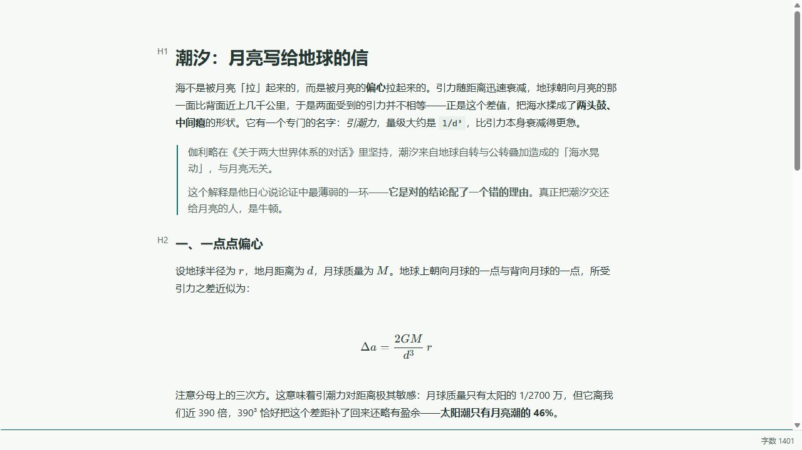
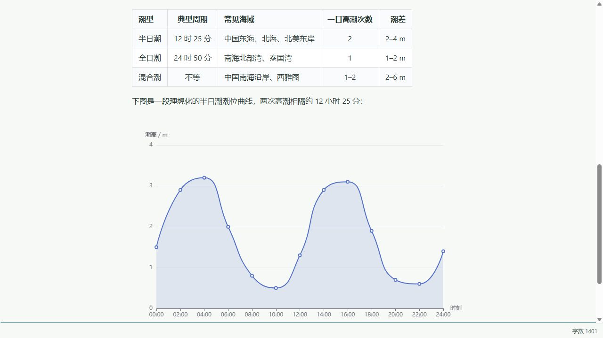

> 就像买了比亚迪秦的车主忍不住跑一单网约车一样，谁用了ai能忍住不造两个轮子玩玩呢
# tide

轻量级单文件 Markdown 编辑器。采用 Typora 式的即编即显（Instant Rendering）模式，界面极简，完全离线可用，适合日常记笔记、写文档。

## 软件截图

以下截图展示了 [示例文档](docs/showcase.md) 在编辑器中的效果。

正文、引用与数学公式：

表格与潮位图表：

## 核心特性

- **单文件模型**：一次只编辑一个 Markdown 文件，打开即用，没有工作区、标签页等多余概念
- **图片显示**：支持网络图片，以及相对于当前 Markdown 文件的本地图片
- **图片粘贴**：粘贴的图片保存在当前 Markdown 文件旁的 `images/` 目录，并使用相对路径引用；未命名文档会先提示保存
- **潮笺右键菜单**：选中文字快速设置 Markdown 格式，并按段落、链接或图片提供相关操作
- **链接打开**：Ctrl+左键（macOS 为 Command+左键）打开网站与本地 Markdown 文档，右键菜单同样可用；本地文档在当前窗口打开，保存与冲突保护照常生效
- **打开与保存**：使用 Ctrl+O 或拖拽打开文件；Ctrl+S 保存，未命名文档会提示选择保存位置
- **防抖自动保存 + 原子写入**：停止输入后自动保存，先写临时文件再重命名，避免写入中断导致文件损坏
- **外部变更监视**：文件被其他程序修改时静默重载（无未保存修改的情况下）；有未保存修改则暂停自动保存并提示冲突，由你决定保留哪个版本
- **脏状态退出保护**：有未保存修改时关闭窗口会先询问，防止误丢内容
- **明暗主题**：状态栏可选浅色、深色或跟随系统，选择会保存在本机
- **正文栏宽**：状态栏滑块调整正文宽度，也可按当前窗口适应；选择保存在本机

## 下载与使用

Windows 版在 [Releases](../../releases) 提供两种下载：

- `tide_<版本>_x64-setup.exe`：安装版，可注册 Markdown 文件关联。
- `tide_<版本>_x64-portable.exe`：单文件便携版，下载后直接运行，无需安装；主题和正文栏宽等偏好仍保存在当前电脑上，不会随程序文件携带。

便携版需要系统已安装 [Microsoft Edge WebView2 Runtime](https://developer.microsoft.com/microsoft-edge/webview2/#download-section)；Windows 11 通常已自带，缺少时请先安装。安装版会在需要时处理该依赖。

## 技术栈

- [Tauri 2](https://tauri.app/)（桌面框架）
- [Vite](https://vite.dev/) + TypeScript
- [Vditor](https://github.com/Vanessa219/vditor)（IR 即时渲染模式）
- Rust（[notify](https://github.com/notify-rs/notify) 文件监视）

## 依赖协议

| 依赖 | 协议 |
| --- | --- |
| Tauri | MIT / Apache-2.0 |
| Vditor | MIT |
| notify | MIT |
| url | MIT / Apache-2.0 |
| percent-encoding | MIT / Apache-2.0 |
| tauri-plugin-dialog | MIT / Apache-2.0 |
| Vite | MIT |
| Vitest | MIT |

## 更新日志

见 [CHANGELOG.md](CHANGELOG.md)。

## License

[MIT](LICENSE)
