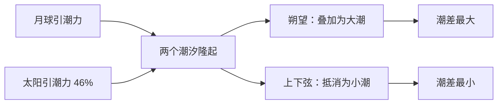

# 潮汐：月亮写给地球的信

海不是被月亮「拉」起来的，而是被月亮的**偏心**拉起来的。引力随距离迅速衰减，地球朝向月亮的那一面比背面近上几千公里，于是两面受到的引力并不相等——正是这个差值，把海水揉成了**两头鼓、中间瘪**的形状。它有一个专门的名字：*引潮力*，量级大约是 `1/d³`，比引力本身衰减得更急。

> 伽利略在《关于两大世界体系的对话》里坚持，潮汐来自地球自转与公转叠加造成的「海水晃动」，与月亮无关。
>
> 这个解释是他日心说论证中最薄弱的一环——**它是对的结论配了一个错的理由**。真正把潮汐交还给月亮的人，是牛顿。

## 一、一点点偏心

设地球半径为 $r$，地月距离为 $d$，月球质量为 $M$。地球上朝向月球的一点与背向月球的一点，所受引力之差近似为：

$$\Delta a=\frac{2GM}{d^{3}}\,r$$

注意分母上的三次方。这意味着引潮力对距离极其敏感：月球质量只有太阳的 1/2700 万，但它离我们近 390 倍，390³ 恰好把这个差距补了回来还略有盈余——**太阳潮只有月亮潮的 46%**。

也正是这个三次方，让潮汐成了一把尺子。阿波罗计划在月球上留下的反射镜，测出月球每年远离地球约 3.8 厘米[^1]；作为代价，地球的自转被潮汐摩擦一点点拖慢，每个世纪长出约 1.7 毫秒[^2]。

## 二、一天两次潮

地球自转一圈是 24 小时，月亮却在这段时间里往前挪了一小段，于是同一个地点再次正对月亮需要 24 小时 50 分——这叫一个**太阴日**，而不是我们钟表上的~~那个 24 小时~~。两个潮汐隆起轮流经过，高潮便每 12 小时 25 分来一次。

| 潮型 | 典型周期 | 常见海域 | 一日高潮次数 | 潮差 |
| :--- | :---: | :--- | :---: | ---: |
| 半日潮 | 12 时 25 分 | 中国东海、北海、北美东岸 | 2 | 2–4 m |
| 全日潮 | 24 时 50 分 | 南海北部湾、泰国湾 | 1 | 1–2 m |
| 混合潮 | 不等 | 中国南海沿岸、西雅图 | 1–2 | 2–6 m |

下图是一段理想化的半日潮潮位曲线，两次高潮相隔约 12 小时 25 分：

```echarts
{
  "backgroundColor": "transparent",
  "tooltip": { "trigger": "axis" },
  "grid": { "left": 52, "right": 44, "top": 36, "bottom": 36 },
  "xAxis": {
    "type": "category",
    "boundaryGap": false,
    "name": "时刻",
    "data": ["00:00", "02:00", "04:00", "06:00", "08:00", "10:00", "12:00", "14:00", "16:00", "18:00", "20:00", "22:00", "24:00"]
  },
  "yAxis": {
    "type": "value",
    "name": "潮高 / m",
    "min": 0,
    "max": 4
  },
  "series": [
    {
      "type": "line",
      "smooth": true,
      "symbolSize": 6,
      "data": [1.5, 2.9, 3.2, 2.0, 0.8, 0.5, 1.3, 2.9, 3.1, 1.9, 0.7, 0.6, 1.4],
      "areaStyle": { "opacity": 0.15 },
      "lineStyle": { "width": 2 }
    }
  ]
}
```

朔望之际，日、地、月近似共线，两个引潮力叠加，潮差最大，称**大潮**；上弦下弦时二者垂直，互相抵消一部分，潮差最小，称**小潮**。渔民的日历比天文学家的公式更早记住了这件事。

## 三、海岸线的形状

潮汐在开阔大洋里其实很斯文，平衡潮的振幅不过半米。真正把潮差推到十几米的，是海岸线自己的形状——芬迪湾像一个漏斗，海水被赶进越来越窄的通道，能量无处可去，只能堆成高度。



潮汐的几种脾气：

1. **半日潮**——最守时的一种，一天两次，几乎不差分秒；
2. **全日潮**——某些海湾只有一个隆起能进来，一天一次；
3. **混合潮**——两次高潮一高一低，像呼吸不均的人。

再往下分，还有更细的层次：

- 按成因
  - 天文潮：月亮与太阳的引力
  - 气象潮：风与气压的推搡
    - 风暴潮：最暴烈的一种
- 按尺度
  - 大潮 / 小潮
  - 朔望潮 / 回归潮

## 四、把月亮的时间换成电

潮汐是少数可以「预报」的可再生能源——你不需要等风来，也不需要等太阳升起，你只需要一张潮汐表。

```python
from datetime import datetime, timedelta

LUNAR_DAY = timedelta(hours=24, minutes=50)   # 一个太阴日
SEMIDIURNAL = LUNAR_DAY / 2                   # 半日潮周期：12h25m

def next_high_tide(now: datetime, last_high: datetime) -> datetime:
    """推算下一次高潮时刻。"""
    nxt = last_high + SEMIDIURNAL
    while nxt <= now:
        nxt += SEMIDIURNAL
    return nxt
```

同样的公式用 Rust 写出来，只差一个类型标注：

```rust
/// 引潮加速度：2 G M r / d³
fn tidal_accel(moon_mass: f64, earth_radius: f64, distance: f64) -> f64 {
    const G: f64 = 6.674e-11;
    2.0 * G * moon_mass * earth_radius / distance.powi(3)
}

fn main() {
    let a = tidal_accel(7.35e22, 6.371e6, 3.844e8);
    println!("引潮加速度约 {:.2e} m/s²", a);
}
```

> 1966 年，法国在朗斯河口建起世界上第一座大型潮汐电站，装机 240 兆瓦，至今仍在发电。
> 它每年发出的电，本质上都是地球自转被月亮拖慢时，漏出来的一点点时间。

## 五、观测者的笔记

站在海边看一次完整的潮汐，你会发现它比任何公式都慢。海水上涨时不喧哗，退去时也不告别，只是在礁石上留下一圈湿痕，像一句说过又收回的话。

> 「潮汐是海洋对月亮的迟到回应。」
> —— 本文

几个随手记下的数字：月球自转与公转周期同为 27.32 天（潮汐锁定），地月平均距离 384 400 公里，芬迪湾最大潮差 16 米。

保存这篇文档用 <kbd>Ctrl</kbd> + <kbd>S</kbd>，打开新文件用 <kbd>Ctrl</kbd> + <kbd>O</kbd>。

---

## 附：元素测试清单

| 元素 | 写法 | 状态 |
| :--- | :--- | :---: |
| 六级标题 | `#` ~ `######` | ✅ |
| 粗体 / 斜体 | `**粗**` `*斜*` | ✅ |
| 删除线 | `~~删除~~` | ✅ |
| 高亮 | `<mark>高亮</mark>` | ✅ |
| 行内代码 | `` `code` `` | ✅ |
| 代码块高亮 | ```` ```python ```` | ✅ |
| 有序 / 无序 / 嵌套列表 | `1.` `-` 缩进 | ✅ |
| 任务列表 | `- [x]` | ✅ |
| 表格与对齐 | `:---:` | ✅ |
| 引用（含嵌套） | `>` | ✅ |
| 分隔线 | `---` | ✅ |
| 链接与自动链接 | `[文字](url)` | ✅ |
| 脚注 | `[^1]` | ✅ |
| 数学公式 | `$...$` `$$...$$` | ✅ |
| Mermaid 图表 | ```` ```mermaid ```` | ✅ |
| ECharts 图表 | ```` ```echarts ```` | ✅ |
| 图片 | `` | ⚠️ 仅 http(s) 地址，`data:` 会被剥掉 |
| 键盘按键 | `<kbd>` | ✅ |
| 折叠块 | `<details>` | ✅ |
| 高亮 | `==文本==` / `<mark>` | ❌ 需在 Vditor 开启 `mark` |
| 上标 / 下标 | `R^2^` `H~2~O` | ❌ 需开启 `sup` / `sub`；未开启时 `~` 会被当成删除线 |
| 目录 | `[toc]` | ❌ 需开启 `toc`，否则按原文显示 |

回归时逐项对照，任何一项不渲染就在这里记一笔：

- [x] 标题层级与锚点
- [x] 行内元素嵌套（**粗体里的 `代码`**、*斜体里的 $a^2$*）
- [x] 表格对齐与长单元格换行
- [x] 代码块横向滚动
- [x] 折叠块 `<details>`（点击标题展开或收起）
- [ ] 目录 `[toc]`——Vditor 不支持，如需目录只能手写锚点

<details>
<summary>折叠块测试</summary>

如果这段文字能展开看到，说明 HTML 块渲染正常。

</details>

[^1]: 月球激光测距（LLR）自 1969 年起持续测量，现代结果约为 3.8 cm/年。
[^2]: 潮汐摩擦导致的地球自转减速，同时使日长每世纪增加约 1.7 ms。
